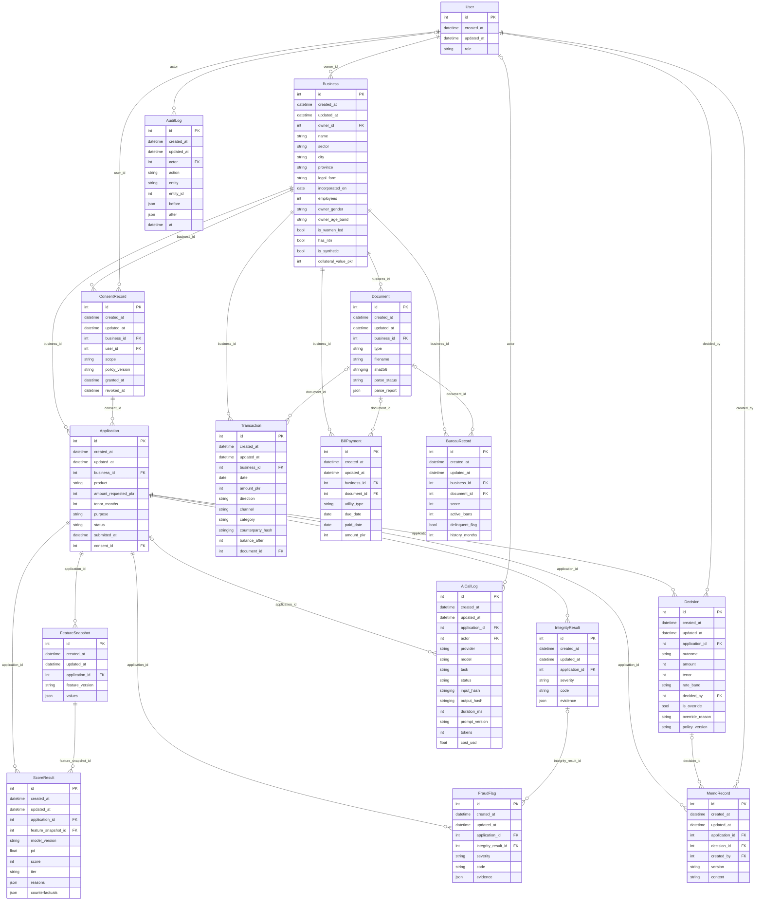

# SME Credit relational model

Money fields are nonnegative integer PKR. Amount sign is represented by direction.
SHA-256 lowercase digests replace counterparty identities. Evidence JSON must be sanitized.
All 16 records have id, created_at and updated_at; foreign keys use RESTRICT deletion.
Audit records are append-only through the ORM; SQL maintenance needs separate controls.

## Shared contracts

Use `app.enums`, `app.db.models`, and `app.schemas.records` in later modules.
Create contracts forbid extra fields and reject fractional/negative money, invalid enums,
and raw account/counterparty keys (including nested JSON). Read contracts support ORM objects.
Relationships are named after the FK without `_id`; inverse collections use plural record names (for example, `business.transactions`).
Consent and linked evidence must be checked against the application business by service code.
Free text must never contain raw account numbers or counterparty names; do not persist raw
LLM prompts or outputs. AiCallLog stores hashes and metadata only.

## Database lifecycle

From backend: `python -m app.db.seed` creates all tables and idempotently seeds synthetic data.
`init_db(seed_hook=...)` accepts a typed session callback in a committed transaction.
`get_db` provides a closing FastAPI dependency; `session_scope` commits or rolls back.
`create_all` bootstraps a new database; it is not a schema migration system.

SQLite returns naive timestamps; stored timestamps represent UTC. Reassign JSON values after
edits so SQLAlchemy tracks them; nested in-place JSON changes are not tracked automatically.
